# Slang Dictionary

Ứng dụng từ điển **slang word** viết bằng **Java Swing**, phục vụ đồ án **Đồ án #1 – Slang Word (CSC13002 – Lập trình ứng dụng Java)**. Giao diện chỉ dùng **đen–trắng (grayscale)**: không có màu nhấn; trạng thái đúng/sai được thể hiện bằng viền đậm, nét đứt và nền xám.

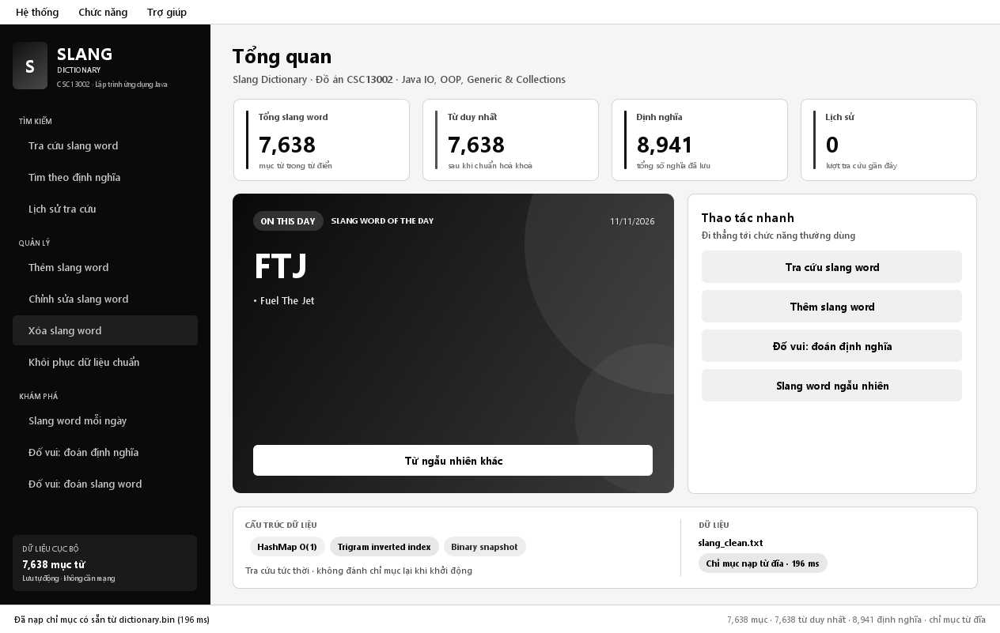

## 1. Chức năng

| # | Chức năng | Cách sử dụng |
|---|-----------|--------------|
| 1 | Tìm kiếm theo slang word | Nhập từ khoá, nhấn **Tìm kiếm** hoặc Enter. Không phân biệt hoa thường; có gợi ý slang word khi đang nhập. |
| 2 | Tìm kiếm theo definition | Nhập chuỗi con của định nghĩa, kết quả hiển thị tất cả slang word có chứa chuỗi đó, có highlight; gợi ý **definition** khi đang nhập. |
| 3 | Lịch sử tra cứu | Tự động ghi mỗi lần tra cứu; hiển thị mới nhất trước, có loại tra cứu, số kết quả, thời gian; xóa được. |
| 4 | Thêm slang word | Nhập word + định nghĩa. Nếu trùng, hộp thoại cho chọn **Ghi đè**, **Thêm bản trùng** hoặc **Hủy**. |
| 5 | Chỉnh sửa | Tìm từ, chọn đúng mục từ, sửa word/định nghĩa và lưu. |
| 6 | Xóa | Tìm từ, chọn đúng mục từ; luôn hỏi xác nhận trước khi xóa. |
| 7 | Reset dữ liệu chuẩn | Khôi phục danh sách từ `slang_clean.txt` (đã chuẩn hoá từ `slang.txt`), có xác nhận. |
| 8 | Random slang word | Slang word “on this day”, có nút đổi từ khác. |
| 9 | Đố vui: word → nghĩa | Hiển thị 1 slang word + 4 định nghĩa; chọn đáp án, đánh dấu đúng/sai bằng viền và tính điểm. |
| 10 | Đố vui: nghĩa → word | Hiển thị 1 định nghĩa + 4 slang word; chọn đáp án, đánh dấu đúng/sai bằng viền và tính điểm. |

Ngoài 10 chức năng chính còn có dashboard thống kê, menu bar, sidebar, phím tắt `Ctrl+1 … Ctrl+0`, `Ctrl+H`, `Ctrl+Q`.

## 2. Cấu trúc dữ liệu và tối ưu tìm kiếm

### Trong bộ nhớ

- `LinkedHashMap<Long, Slang>` giữ toàn bộ mục từ theo thứ tự chèn; mỗi mục từ có id duy nhất nên **hỗ trợ nhiều mục từ trùng tên** (dữ liệu gốc có nhiều bản ghi trùng).
- `HashMap<String, List<Slang>>` ánh xạ **slang word đã chuẩn hoá → danh sách mục từ**. Tra cứu chính xác trung bình **O(1)**.
- `TrigramIndex`: chỉ mục nghịch đảo `trigram → posting list` trên phần định nghĩa đã chuẩn hoá. Truy vấn tìm theo định nghĩa:
  - từ khoá < 3 ký tự: quét tuần tự (rất nhanh với dữ liệu trong bộ nhớ);
  - từ khoá ≥ 3 ký tự: giao các posting list, sau đó kiểm tra lại bằng `String.contains` để loại false-positive.
- `Deque<HistoryEntry>` (ArrayDeque) cho lịch sử, giới hạn 200 mục, mới nhất ở đầu.
- `Slang implements Comparable<Slang>` và `Comparator` tự nhiên để sắp xếp kết quả.

Tất cả cấu trúc generic đều dùng tham số kiểu (`Map<String, List<Slang>>`, `List<Slang>`, `Deque<HistoryEntry>`, `Map<String, int[]>`, …), đáp ứng yêu cầu **Generic + Collections**.

### Lưu trữ và nạp lại

| File | Vai trò |
|------|---------|
| `slang.txt` | Dữ liệu gốc do đề cung cấp (7.656 mục từ, 8.959 định nghĩa). **Không bị sửa**, dùng để đối chiếu. |
| `slang_clean.txt` | Bản đã chuẩn hoá (7.638 mục từ, 8.941 định nghĩa); ứng dụng dùng file này. |
| `data/slang_modified.txt` | Bản làm việc sau add/edit/delete, cùng định dạng text để có thể đọc/mở bằng editor. |
| `data/dictionary.bin` | **Snapshot nhị phân** chứa danh sách mục từ, chỉ mục từ khoá và toàn bộ posting list trigram. |
| `data/history.txt` | Lịch sử tra cứu. |

Chi tiết từng lỗi trong dữ liệu gốc: [`report/SLANG_ERRORS_REPORT.md`](report/SLANG_ERRORS_REPORT.md) và [`report/slang_cleanup_lines.csv`](report/slang_cleanup_lines.csv).

- Snapshot lưu kèm **CRC32 + kích thước + tên file nguồn**. Khi khởi động, nếu fingerprint khớp, ứng dụng đọc thẳng snapshot và **không đánh chỉ mục lại**.
- Nếu snapshot cũ/hỏng/không khớp, chương trình tự rebuild từ file text và ghi snapshot mới.
- Sau mỗi thao tác add/edit/delete/reset, cả file text và snapshot đều được cập nhật (ghi atomic qua file tạm).
- Chức năng reset xóa `slang_modified.txt`, nạp lại `slang_clean.txt` và tạo snapshot tương ứng.

## 3. Cài đặt và chạy

Yêu cầu: **JDK 17+** (đã kiểm thử với Java 23). Không dùng thư viện ngoài, chỉ JDK chuẩn.

```bat
:: Build + chạy toàn bộ kiểm thử + tạo jar
test.bat

:: Chạy ứng dụng
run.bat
```

Hoặc thủ công:

```powershell
powershell -NoProfile -ExecutionPolicy Bypass -File build.ps1
java -jar dist\SlangDictionary.jar
```

- Lần chạy đầu tiên sẽ tạo thư mục `data/` và snapshot chỉ mục.
- Nếu chạy jar ở thư mục khác, ứng dụng tự trích xuất `slang.txt` và `slang_clean.txt` đi kèm trong jar.
- Có thể mở project bằng IDE (Eclipse/IntelliJ/NetBeans) hoặc dùng `pom.xml` có sẵn.

### Chế độ kiểm thử giao diện

```bat
java -jar dist\SlangDictionary.jar --smoke-test
```

Mở lần lượt 11 màn hình, chụp 15 ảnh (thêm 2 ảnh gợi ý autocomplete và 2 trạng thái quiz đã trả lời) vào `report/screens/` rồi thoát. Đây là smoke-test cho toàn bộ UI; ảnh được chuyển sang grayscale.

## 4. Kiểm thử và hiệu năng

Chạy `test.bat` (hoặc `AllTests`) cho kết quả **94/94 kiểm tra đạt**:

- Parser và dữ liệu chuẩn (7.638 mục / 8.941 định nghĩa; raw 7.656 / 8.959 để đối chiếu, dòng định nghĩa nối tiếp).
- Tìm theo word: chính xác, không phân biệt hoa thường, trim, gợi ý prefix.
- Tìm theo definition: đối chiếu **brute-force** trên 6 từ khoá, mọi kết quả đều chứa keyword.
- Add / overwrite / duplicate / edit / delete / validate index.
- Persistence: snapshot, phát hiện snapshot hỏng, phát hiện file text thay đổi, reset.
- History: thứ tự, persistence, giới hạn 200, clear.
- Quiz: 400 câu, luôn có 4 đáp án duy nhất và đáp án đúng.
- Hiệu năng với **100.000 slang word**:

| Phép đo | Kết quả |
|---------|---------|
| Xây dictionary + trigram index | ~300 ms |
| 200 lần tra cứu chính xác | < 1 ms (tổng) |
| Tìm definition `"money"` | ~1 ms (587 kết quả) |
| Tìm definition `"go"` | ~20 ms (5.152 kết quả) |
| Tìm definition `"the"` | ~7 ms (7.536 kết quả) |
| Lưu text + snapshot (14 MB) | ~400 ms |
| Nạp snapshot lần sau | ~600 ms, `indexLoaded=true` |
| Bộ nhớ dùng khi test 100k | ~184 MB |

Tất cả đều **dưới 1 giây** cho thao tác tìm kiếm, đáp ứng yêu cầu của đề. Chi tiết xem [`report/test-results.txt`](report/test-results.txt) và [`report/KIEM_THU.md`](report/KIEM_THU.md).

## 5. Ảnh giao diện

| | |
|---|---|
| 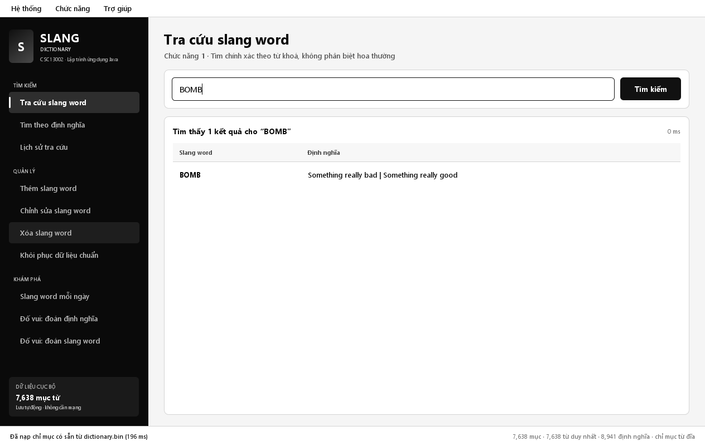 | 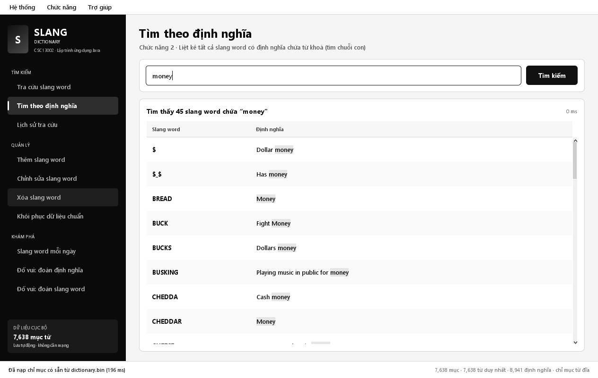 |
| 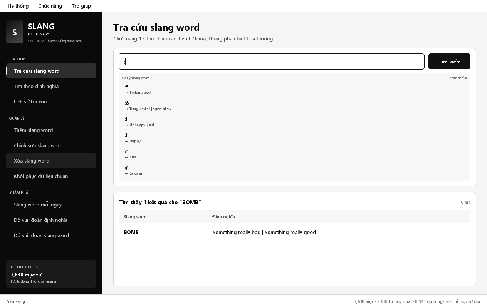 | 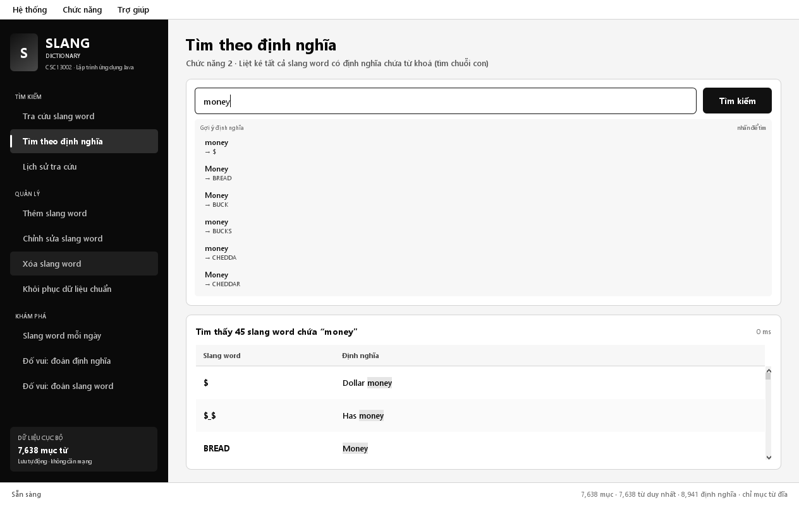 |
| 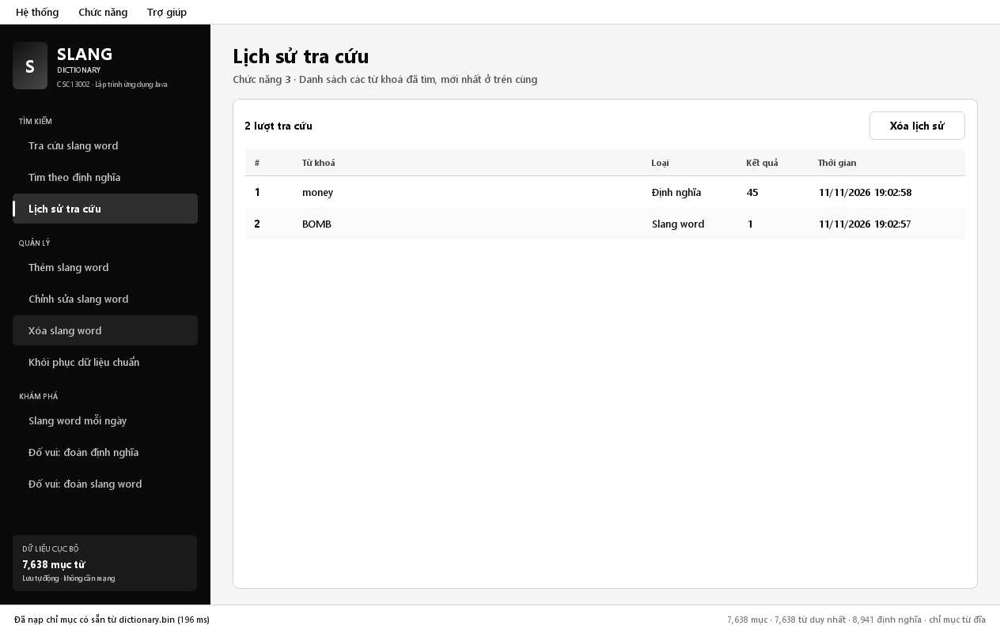 | 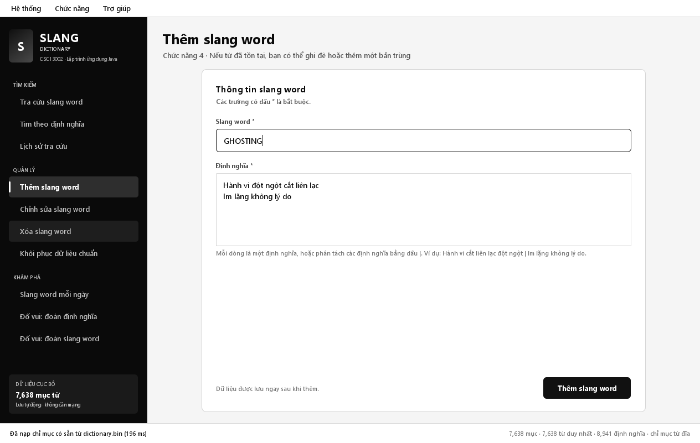 |
| 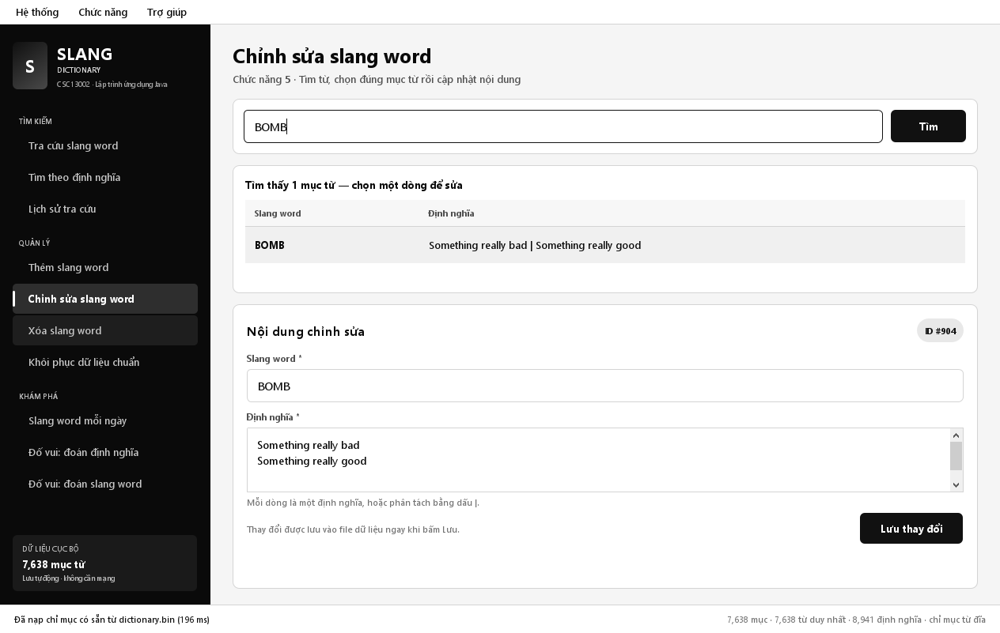 | 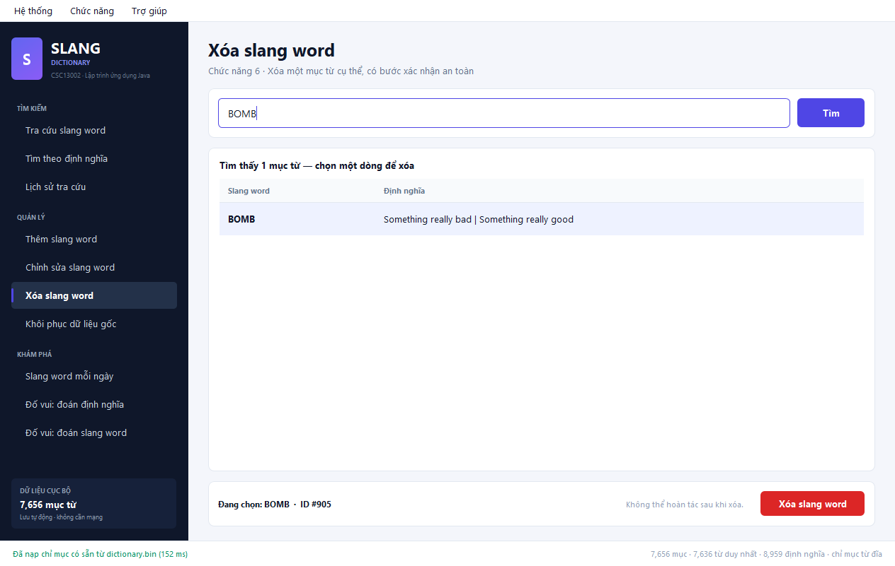 |
| 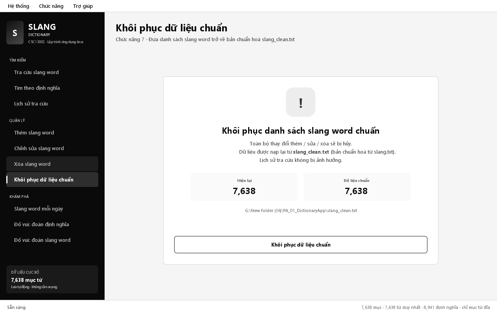 | 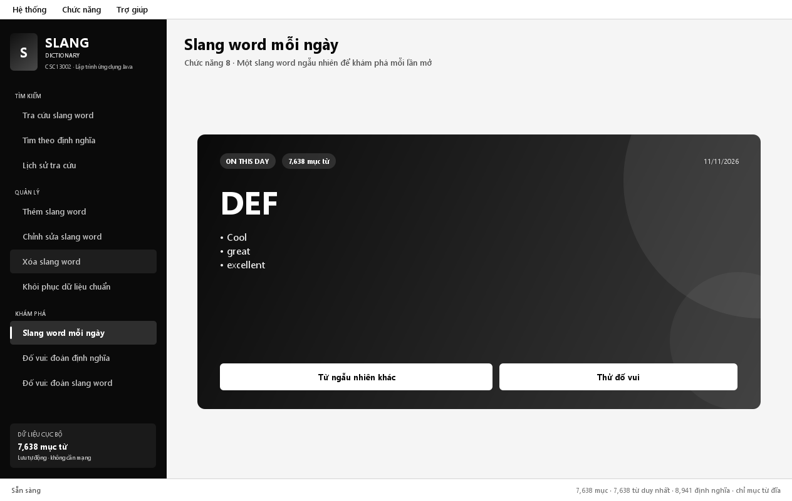 |
| 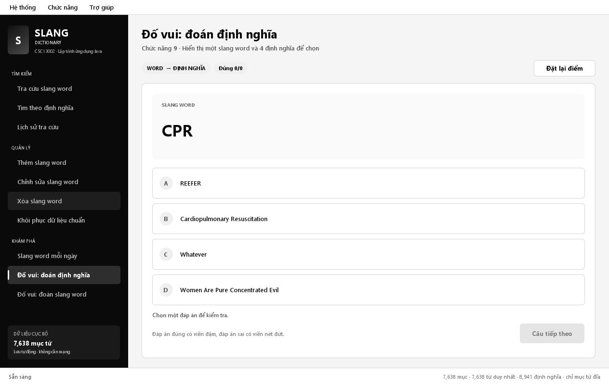 | 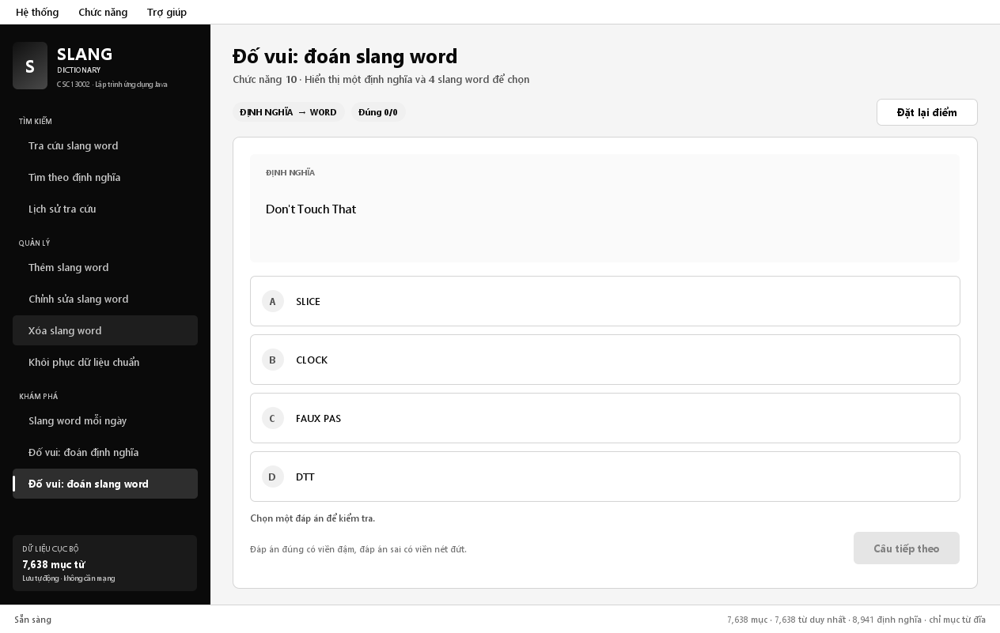 |
| 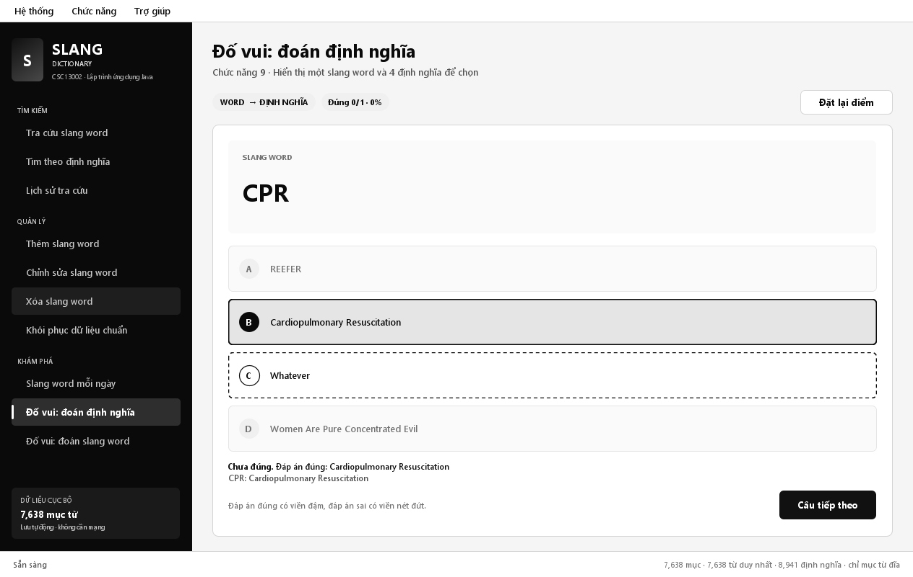 | 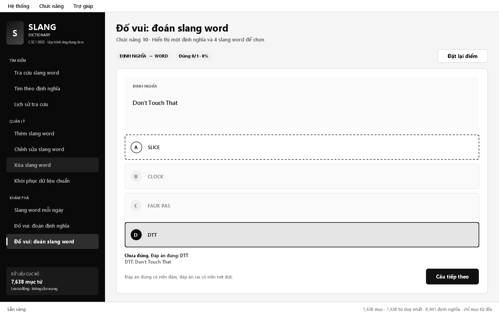 |

Báo cáo đầy đủ: [`report/BAO_CAO_DO_AN.docx`](report/BAO_CAO_DO_AN.docx) và [`report/BAO_CAO_DO_AN.pdf`](report/BAO_CAO_DO_AN.pdf).

## 6. Cấu trúc thư mục

```text
PA_01_DictionaryApp/
├─ slang.txt                     # dữ liệu gốc (không sửa)
├─ slang_clean.txt               # dữ liệu đã chuẩn hoá (ứng dụng dùng)
├─ build.ps1 / test.bat / run.bat
├─ pom.xml
├─ src/main/java/vn/edu/hcmus/slang/
│  ├─ App.java, AppPaths.java, BootData.java, ScreenshotMode.java
│  ├─ model/    Slang, HistoryEntry, QuizQuestion
│  ├─ data/     SlangDictionary, TrigramIndex, DictionaryStore, DictionarySnapshot
│  ├─ service/  HistoryService, QuizService
│  ├─ util/     TextNormalizer, Snippet
│  └─ ui/       MainFrame, Theme, Dialogs, components, panels
├─ src/main/resources/data/slang.txt   # raw đi kèm jar
├─ src/main/resources/data/slang_clean.txt # dữ liệu chuẩn đi kèm jar
├─ src/test/java/.../AllTests.java
├─ report/      báo cáo docx/pdf, ảnh, kết quả test, tự đánh giá, kịch bản video
└─ data/        sinh ra khi chạy (working file, snapshot, history)
```

## 7. Đóng gói bài nộp

```powershell
powershell -NoProfile -ExecutionPolicy Bypass -File package.ps1 `
    -Mssv 22123456 -VideoUrl "https://youtu.be/..." -Score 100
```

Script build lại jar, kiểm tra test, rồi tạo file `22123456_100.zip` đúng quy ước `MSSV_SoDiemTuDanhGia.zip`, gồm source, jar, dữ liệu (raw + cleaned), ảnh chụp màn hình, kết quả test, file tự đánh giá và kịch bản video.

> **Lưu ý commit:** repo cần có tối thiểu 10 commit và ảnh chụp các lần commit trên GitHub/Bitbucket/GitLab. Hãy push repo và chụp lại lịch sử commit trước khi nộp. Ảnh lịch sử local có sẵn tại `report/commits/local-git-log.png` (chỉ là minh chứng tạm, cần thay bằng ảnh GitHub).

## 8. Tham khảo

- Dữ liệu `slang.txt`: do đề bài cung cấp.
- Mã nguồn: viết mới, **không copy mã nguồn bên ngoài**, chỉ dùng **JDK chuẩn** (Java SE 17+). Tỷ lệ tham khảo: **0%**.
- Các khái niệm generic, bounded type parameter, `Comparable`/`Comparator`, `Iterator` được vận dụng theo tài liệu môn học.

## 9. Tự đánh giá

Xem [`report/TuDanhGia.txt`](report/TuDanhGia.txt): **100/100** (10 chức năng × 10 điểm).

